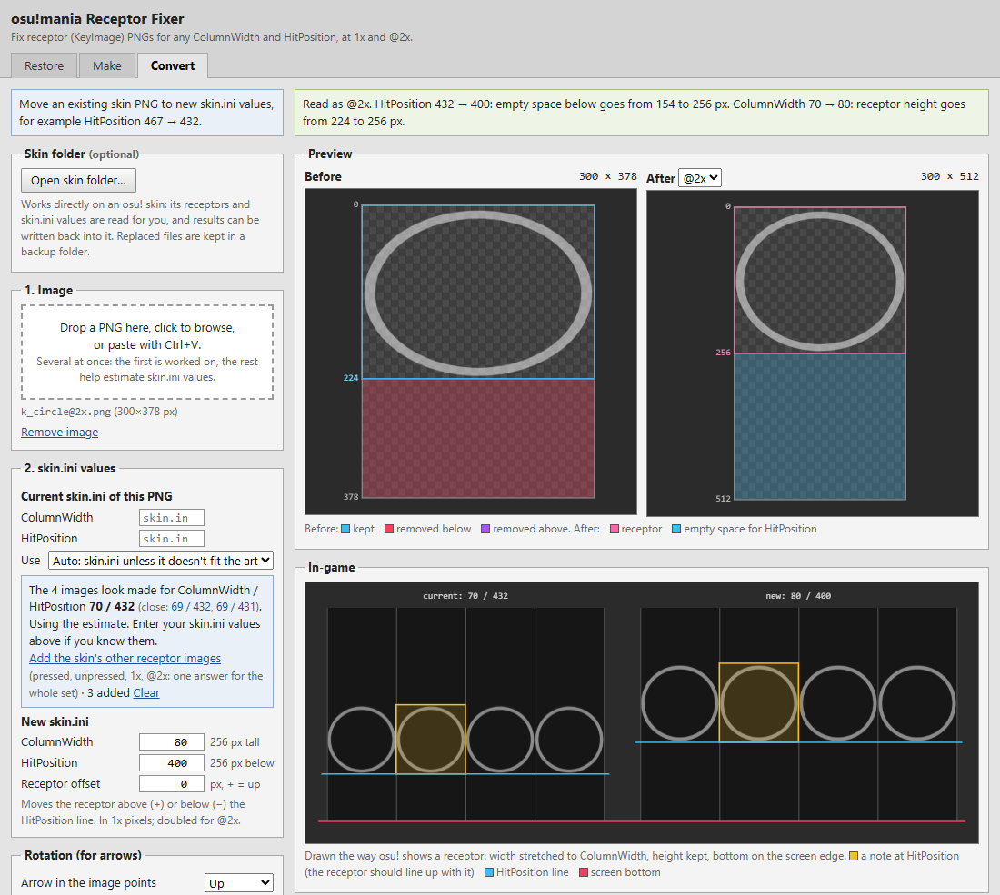
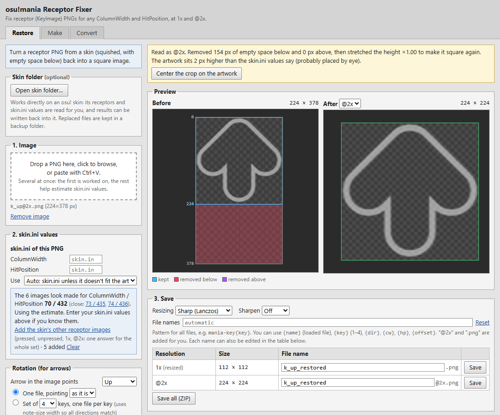
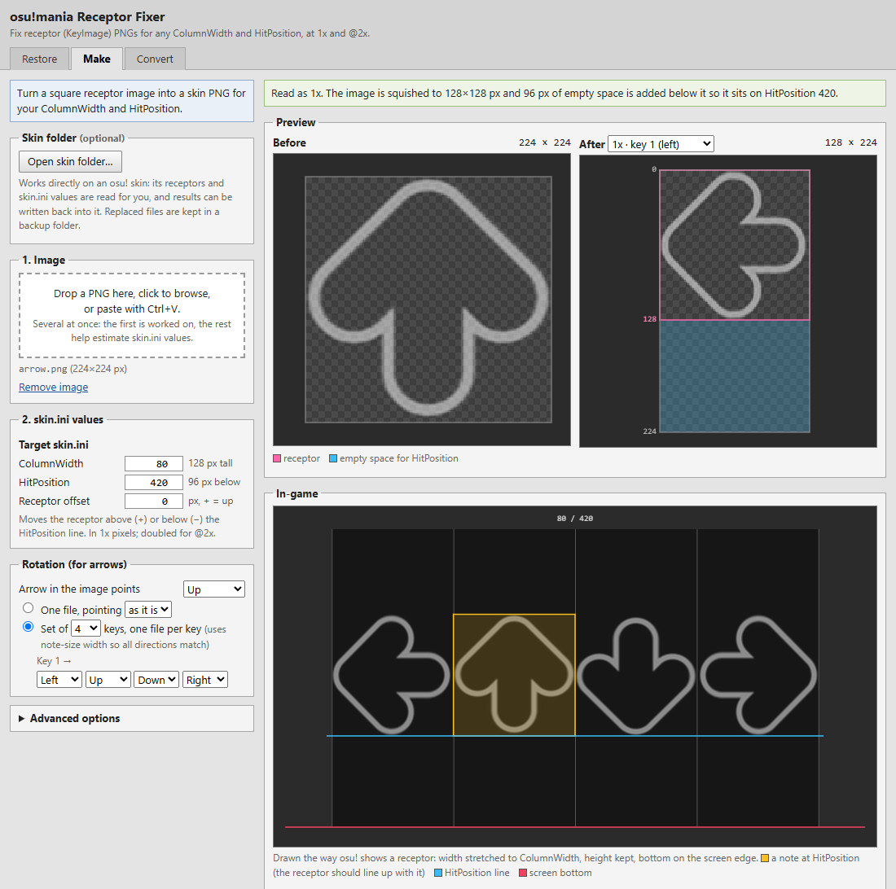
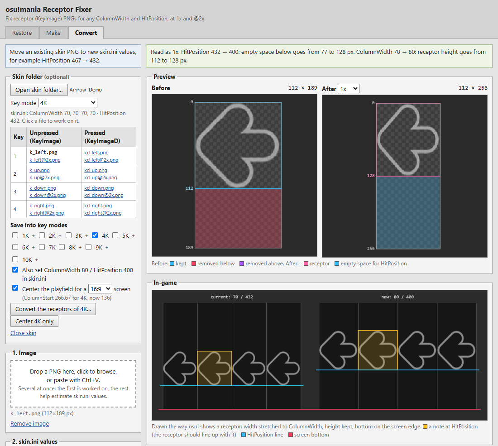

# osu!mania Receptor Fixer

Fix osu!mania receptor images for any `ColumnWidth` and `HitPosition`.

## Features

- **Restore:** turn a skin receptor back into a square image.
- **Make:** turn a square image into a receptor, or a full arrow set (1–10 keys).
- **Convert:** move a receptor to new values, for example `HitPosition` 467 → 432.
- **Skin folder:** open a skin and convert all its receptors at once, for any key mode (1K–10K).
- **Centering:** center the playfield for your screen ratio.
- **Lane cover:** a `mania-stage-bottom` cover from the top or bottom, only as wide as the columns.
- **Auto-detect:** finds the values a receptor was made for.
- **1x and @2x:** both saved, with an in-game preview.

## Screenshots

### Restore

### Make

### Skin folder

> [!NOTE]
> When saving into a skin, the old files are backed up to `_receptor backup` inside the skin folder.

## Run

- **Windows:** `Receptor Fixer.exe` is in this repo's Releases. No install needed.
- **Browser:** open `index.html`. Opening skin folders needs Chrome or Edge.

Everything runs locally. Nothing is uploaded.

## Build the exe

Run `desktop\build.bat` (needs Python 3.9+). Output: `dist\Receptor Fixer.exe`.
